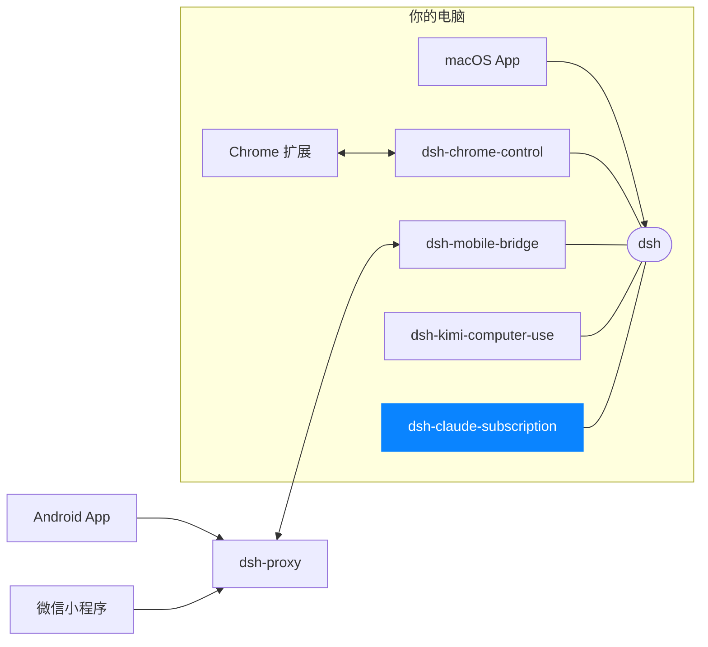

# dsh-claude-subscription

[English](README.md)

在 **DeepSeek Harness 里直接用你的 Claude Code 订阅**跑 Claude 模型 —— 不需要另买
Anthropic API key，也不按 token 计费。

你只需要用 `claude` CLI 登录一次。这个 bundle 会把这个凭证交给 harness 内置的
Anthropic 提供商，于是 DSH 和 CLI 共用同一份订阅。

## 你能得到什么

- **DSH 里用上 Claude 模型** —— Opus、Sonnet、Haiku，取决于你的套餐。
- **不用买、不用贴 API key。** 这台机器上 `claude` 能用，DSH 就能用。
- **保持登录。** token 在后台自动续期。
- **一份凭证，不是两份。** 续期会写回 CLI，所以 CLI 继续可用，你不用登录两次。
- **不打扰其他配置。** 其他 provider、默认模型、模型列表都不动。
- **任何 profile 都能装。**

## 前置条件

- **macOS。** 凭证从登录钥匙串读取。
- **Claude Code 订阅**（Pro / Max / Team），且至少登录过一次。
- 已安装 DSH，且 `claude` CLI 在 `PATH` 里。

## 安装

```sh
dsh plugin --profile web add @dshapp/dsh-claude-subscription
```

然后**重启 harness** —— `dsh plugin` 只负责安装、不启动 profile，所以正在运行的
`dsh web` 还没加载它。

## 登录一次

如果这台机器上从没用过 CLI：

```sh
claude
```

完成浏览器登录即可。插件没有别的要配 —— 下次 harness 启动时会自己找到凭证，
Anthropic 路由随即可用。

## 选模型

`anthropic` 路由默认提供内置 catalog 里的**全部** Claude 模型，所以多数人不需要做
任何事：打开 **Models** 页面挑一个就行。

想用 catalog 里没有的模型（比如更新的版本），在 profile 的 `cordis.patch.yml` 里声明：

```yaml
- id: llm-pi-ai
  config:
    providers:
      anthropic:
        models:
          - id: claude-opus-5-5
            input:
              - text
              - image
```

> **注意：** 声明 `models` 会**整体替换该路由的 catalog**，而不是追加。只列一个
> 模型，这条路由就**只有**那一个模型。想同时保留 catalog 里的模型，要么把它们全列
> 出来，要么干脆不写这个字段、直接从 catalog 里选。

本 bundle 自己从不写 `models`，所以你在这里声明的内容会原样保留。

## 配置项

**没有配置项。** 订阅凭证只有一种合理的存放位置、一个引用名、一套续期节奏，所以本
bundle 直接写死，而不是暴露出「唯一正确取值就是默认值」的旋钮：

- 路由 `anthropic`，显示为 **anthropic**，解析 `ANTHROPIC_API_KEY`
- 凭证自动定位，续期自动写回
- 只在 token 真的过期后才续期，每 5 分钟重新检查一次
- 别的客户端先续期了，就直接采用它的凭证，不覆盖
- 请求被 `AUTH` 拒绝时立即重读凭证，并重试该步骤一次
- 续期前的备份放在 `$DSH_HOME/claude-subscription`

想改任何一项，直接改 `lib/index.js` —— 常量都在文件顶部。

## 日常表现

- harness 启动后片刻，路由即可用。
- token 大约每 8 小时自动续期一次；插件每 5 分钟检查一次，只在确实需要时才动作。
- 续期会换发新的 access token，而换发会让这台机器上其他 Claude 客户端手里的 token
  失效。所以本 harness 不提前续期：只有凭证真的过期后才续期；如果是 `claude` CLI
  或其他客户端先续期了，下一次检查直接采用钥匙串里的新凭证，不再换发。
- 长时间没开 harness？下次启动会自动续期，你不需要做什么。
- 用 `claude` 登录成了别的账号？下一次检查会采用新凭证。
- 别的 Claude 客户端刷新了共享登录、把本 harness 手里的 token 吊销了？被拒的那次请求
  会重新读取凭证并重试该步骤一次，这一轮不会失败。

## 常见问题

| 现象 | 原因与处理 |
| --- | --- |
| 日志出现 `no Claude Code credential …`，Anthropic 路由报错 | 这台机器还没登录。运行 `claude` 完成登录。 |
| Models 页面里找不到这条路由 | harness 安装后还没重新加载 bundle。重启它。 |
| `401` / "OAuth access token has been revoked" | 别的 Claude 客户端刷新了共享登录，token 已失效。插件会自动重读凭证并重试该步骤一次；如果仍然失败，说明登录本身没了，运行 `claude` 重新登录。 |
| `429 rate_limit_error` | 你套餐的速率限制，不是 bug。等一会儿，或换小一点的模型。 |
| 只能选到一个 Claude 模型 | 该路由声明了 `models` 列表，它会替换 catalog。见[选模型](#选模型)。 |
| DSH 用过之后 `claude` CLI 不能用了 | 两者共用一份凭证。用 `claude` 重新登录，DSH 会跟上。 |

## 说明

- **与 Anthropic 无关联。** 这是一个互操作性插件。它复用你已有的凭证，本身不授予
  任何访问权限。
- **你的订阅，你的条款。** 把订阅凭证共享给另一个客户端是你的选择，可能不完全符合
  Anthropic 的服务条款。请按"在自己机器上使用 CLI"的方式来使用它。
- **一份凭证，两个客户端。** DSH 和 `claude` 共用同一个登录会话，任何一边登出都会
  影响另一边。

## 许可证

[MIT](LICENSE)

<!-- dsh-family:start -->
## DSH App 家族

**DSH App** 是为 [DeepSeek Harness](https://github.com/deepseek-ai/deepseek-harness)（`dsh`）打造的一组客户端与插件。它们都接入你电脑上**同一个** dsh——会话、模型与插件处处互通，按需组合即可。下载与文档见 **[dshapp.github.io](https://dshapp.github.io/)**。



| | 项目 | 做什么 | 链接 |
| --- | --- | --- | --- |
| 客户端 | **macOS App**<br>`dsh-macapp` | 原生 SwiftUI 客户端，托管本机 dsh，一站式开启各个扩展 | [介绍](https://dshapp.github.io/products/macos/) · 源码待公开 |
|  | **Android App**<br>`dsh-androidapp` | 口袋里的 DSH：审批、提问、通知，端到端加密连回电脑 | [介绍](https://dshapp.github.io/products/android/) · 源码待公开 |
|  | **微信小程序 DSH Remote**<br>`dsh-miniapp` | 免安装，iPhone / Android 的微信里扫码接管 DSH | [介绍](https://dshapp.github.io/products/miniapp/) · 源码待公开 |
|  | **Chrome 扩展**<br>`dsh-chrome-extension` | 浏览器侧栏里的 DSH 客户端，也是浏览器控制的执行端 | [介绍](https://dshapp.github.io/products/chrome/) · 源码待公开 |
| dsh 插件 | **浏览器控制**<br>`dsh-chrome-control` | 把你已登录的 Chrome 作为 `mcp__chrome__*` 工具交给 Agent | [介绍](https://dshapp.github.io/products/chrome/) · [源码](https://github.com/dshapp/dsh-chrome-control) |
|  | **移动端桥接**<br>`dsh-mobile-bridge` | 经 Noise 加密隧道把 dsh 交给已配对的手机，不开端口 | [介绍](https://dshapp.github.io/products/android/) · [源码](https://github.com/dshapp/dsh-mobile-bridge) |
|  | **电脑操作**<br>`dsh-kimi-computer-use` | 让 Agent 在后台操作没有 API 的 Mac 应用 | [介绍](https://dshapp.github.io/products/cu/) · [源码](https://github.com/dshapp/dsh-kimi-computer-use) |
|  | **Claude 订阅** ← 你在这里<br>`dsh-claude-subscription` | 用 Claude Code 订阅在 DSH 里跑 Claude 模型，不用另买 API Key | — |
| 基础设施 | **中转服务**<br>`dsh-proxy` | 手机远程唯一的公网组件：单端口、只转发密文、无状态 | [介绍](https://dshapp.github.io/docs/crypto/) · [源码](https://github.com/dshapp/dsh-proxy) |
|  | **产品站**<br>`dshapp.github.io` | 下载、文档与更新日志 | [介绍](https://dshapp.github.io/) · [源码](https://github.com/dshapp/dshapp.github.io) |
<!-- dsh-family:end -->
